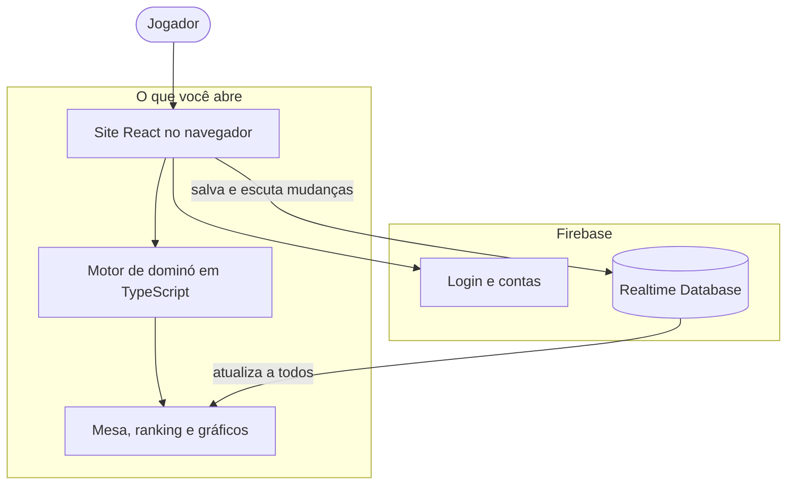

<div align="center">

# Domino Vittas

### Seu clube de dominó: estatísticas, ranking e uma mesa de jogo de verdade — tudo no navegador.

[](https://react.dev/)
[](https://www.typescriptlang.org/)
[](https://vite.dev/)
[](https://tailwindcss.com/)
[](https://firebase.google.com/)
[](https://vitest.dev/)
[](https://vercel.com/)

**🀰 Mesa jogável · 📊 Estatísticas · 🏆 Ranking · 👥 Duplas · 🔄 Tempo real**

🌐 **Site:** [domino-self-rho.vercel.app](https://domino-self-rho.vercel.app)

</div>

---

## 📑 Índice

| | |
|---|---|
| [🎯 O que é](#o-que-e) | [🀰 As regras do jogo](#as-regras-do-jogo) |
| [✨ Funcionalidades](#funcionalidades) | [🔥 Como joga](#como-joga) |
| [🧩 Como funciona](#como-funciona) | [🚀 Como rodar](#como-rodar) |
| [🧪 Testes](#testes) | [☁️ Deploy](#deploy) |
| [🛠️ Tecnologias](#tecnologias) | [📝 Notas](#notas) |

---

<a id="o-que-e"></a>

## 🎯 O que é

O Domino Vittas é um **painel para jogadores de dominó**. Ele reúne, no mesmo lugar, o histórico de partidas, as estatísticas de cada jogador, o ranking do clube e — a melhor parte — **uma mesa de dominó que você pode jogar de verdade** com outras pessoas.

Pense nele como o "perfil esportivo" de quem joga dominó: você vê quantas partidas ganhou, como evoluiu, quem está no topo do ranking e pode começar uma partida ali mesmo, escolhendo 2, 3 ou 4 jogadores, individual ou em duplas.

> 💡 **Em uma frase:** um dashboard de dominó que também coloca a mesa na tela, com peças, turnos, placar e sincronização entre jogadores.

**Não é** um sistema de reserva de quadra, não tem chat, sala com código de convite nem oponente robô. A partida começa a partir da lista de jogadores cadastrados.

---

<a id="funcionalidades"></a>

## ✨ Funcionalidades

| Recurso | O que faz, em palavras simples |
|---|---|
| 🔐 **Login** | Entre com apelido e senha; o sistema cria um e-mail interno automaticamente |
| 🀰 **Mesa de dominó** | Peças em SVG, mão do jogador, turno, passes, placar e resultado animados |
| 👥 **Partidas** | Crie jogos de 2, 3 ou 4 pessoas — individual ou em duplas |
| 🔄 **Tempo real** | O que um jogador faz aparece na tela dos outros na hora, via Firebase |
| 🏆 **Ranking** | Filtre por nome, cidade ou clube e veja quem tem mais pontos |
| 📊 **Estatísticas** | Gráficos de evolução, taxa de vitória e vitórias por período |
| 📜 **Histórico** | Lista de partidas com filtros e paginação |
| 🤝 **Duplas** | Crie times, envie convites e acompanhe o ranking das duplas |
| ⚙️ **Perfil e ajustes** | Tema claro/escuro, notificações locais e dados do jogador |
| 🔍 **Zoom** | Ajuste o tamanho da mesa para caber na tela |
| 🌱 **Dados de exemplo** | 15 jogadores, mais de 80 partidas antigas, duplas e torneios fictícios |

---

<a id="como-funciona"></a>

## 🧩 Como funciona



**Traduzindo:** não existe um servidor próprio. O site conversa direto com o **Firebase**, que guarda jogadores, partidas, times e o estado da mesa. Quando alguém joga uma peça, o Firebase avisa os outros navegadores — por isso a mesa atualiza sem recarregar a página.

O **motor do jogo** (`src/shared/lib/domino/`) é um pedaço de código puro, separado da interface: ele embaralha, distribui, valida jogadas, conta pontos e decide quem ganhou. Isso facilita testar as regras sem precisar abrir o site.

---

<a id="as-regras-do-jogo"></a>

## 🀰 As regras do jogo

O motor implementa o **block dominoes** (sem comprar peças do monte):

| Regra | Como funciona |
|---|---|
| 🃏 Baralho | **28 peças** (double-six), **7 para cada jogador** |
| 🎬 Abertura | Quem tem a maior dupla começa; se não houver duplas, quem tem a maior soma |
| ➡️ Jogada | Encaixe uma peça pela ponta esquerda ou direita da corrente |
| ⏭️ Sem jogada | O jogador **passa a vez**; se todos passarem seguidos, a mão trava |
| 🏁 Vitória | Quem esvazia a mão leva os pontos dos adversários; em mesa travada, vence quem tem menos pontos |
| 🎯 Fim da partida | Ao chegar na meta de **100 pontos** (configurável) |
| 🚫 "Buchuda" | Quando o adversário termina sem jogar nenhuma peça, o resultado é marcado |

> ⚠️ O motor suporta **2 e 4 jogadores** (com duplas, os assentos 0/2 são o Time A e 1/3 o Time B). Partidas de **3 jogadores** existem no cadastro, mas a mesa não é jogável — nesse caso o vencedor é confirmado manualmente.

---

<a id="como-joga"></a>

## 🔥 Como joga

1. Faça login (ou cadastre um apelido).
2. No menu de partidas, clique em **criar partida**.
3. Escolha o número de jogadores e se é individual ou duplas.
4. Selecione as pessoas na lista e inicie.
5. A mesa aparece: cada jogador vê suas peças e o turno atual.
6. Clique na peça para jogar (ou passe, se não der).
7. Ao fim da mão, o placar é atualizado e a próxima mão começa.
8. Ao atingir a meta, a vitória é confirmada e vai para o histórico e para as estatísticas.

---

<a id="testes"></a>

## 🧪 Testes

São **34 testes** com Vitest, todos no motor do jogo:

| Arquivo | Casos | O que cobre |
|---|---|---|
| `deck.test.ts` | 8 | Embaralho e distribuição das 28 peças |
| `engine.test.ts` | 26 | Turnos, passes, bloqueio, pontuação e 75 simulações completas (25 sementes × 3 configurações) |

```bash
npm test
```

---

<a id="como-rodar"></a>

## 🚀 Como rodar

### Requisitos

| Requisito | Observação |
|---|---|
| Node.js | versão não fixada no repositório (sem `.nvmrc` nem `engines`) |
| npm | há `package-lock.json` — use `npm ci` para uma instalação idêntica |
| Conta Firebase | as credenciais web já estão no código; para seu próprio projeto, edite `src/shared/config/firebase.ts` |

### Passos

```bash
git clone https://github.com/Tyago-santos/domino.git
cd domino
npm ci
npm run dev
```

Abra o endereço mostrado pelo Vite (normalmente **http://localhost:5173**).

### Outros comandos

```bash
npm run build     # tsc -b && vite build → gera dist/
npm run preview   # serve o build localmente
npm test          # roda os 34 testes do motor
npm run lint      # eslint . (cuidado: não há arquivo de config no repo)
```

> 📌 **Não existe `.env.example`**. A variável `VITE_API_URL` aparece em `src/shared/api/client.ts`, mas esse cliente não é usado em nenhuma tela — ou seja, não é preciso configurar nada para rodar.

### Estrutura do projeto

```text
domino/
├── src/app/            entrada, rotas, providers e layout do dashboard
├── src/components/ui/   botões, cards, tabelas e outros componentes reutilizáveis
├── src/features/
│   ├── dashboard/      KPIs, gráficos e últimas partidas
│   ├── match/          criação de partidas e mesa de dominó
│   ├── doubles/        times e ranking de duplas
│   ├── ranking/        ranking de jogadores
│   ├── statistics/     gráficos de desempenho
│   ├── history/        histórico com filtros
│   ├── profile/ e settings/
├── src/shared/lib/domino/  motor puro do jogo + testes
├── src/shared/services/    integração com Firebase
└── public/logo.png     logotipo
```

---

<a id="deploy"></a>

## ☁️ Deploy

O site está publicado na **Vercel** em [domino-self-rho.vercel.app](https://domino-self-rho.vercel.app). O `vercel.json` redireciona todas as rotas para o `index.html`, como é necessário para uma aplicação de página única.

Não há Docker, pipelines de CI ou configuração de infraestrutura versionada.

---

<a id="tecnologias"></a>

## 🛠️ Tecnologias

| Camada | Stack |
|---|---|
| 🧑‍💻 Linguagem | TypeScript 5.7 |
| 🌐 Interface | React 19 · Vite 6 · Tailwind CSS 4 · React Router 7 |
| 📦 Estado e dados | TanStack Query · Firebase Auth · Firebase Realtime Database |
| 🎨 Visual | Framer Motion · anime.js · Recharts · lucide-react · sonner |
| ✅ Qualidade | Zod · Vitest (34 testes) |
| ☁️ Deploy | Vercel |

---

<a id="notas"></a>

## 📝 Notas

- 📌 O repositório se chama `domino`, mas o projeto é **Domino Vittas** (nome no `package.json` e no título da página).
- 📌 O arquivo `mardown.md` descreve recursos que **não existem de fato** (torneios com página, amigos, conquistas, calendário, notificações reais e IA). Considere-o uma especificação antiga.
- 📌 As mãos dos adversários ficam no nó do Realtime Database e **podem ser lidas por qualquer jogador via DevTools** — é um projeto de estudo/demonstração, não um jogo competitivo seguro.
- 📌 `firestore.rules` existe, mas o app usa **Realtime Database**, que não tem regras versionadas no repositório.
- 📌 `npm run lint` não tem arquivo de configuração do ESLint; `axios` e `VITE_API_URL` estão no código, mas não são usados.

---

<div align="center">

Feito com 🀰 por **Tiago Santos**

[](https://github.com/Tyago-santos)
[](https://www.linkedin.com/in/tiago-santos-b10165376/)

</div>
